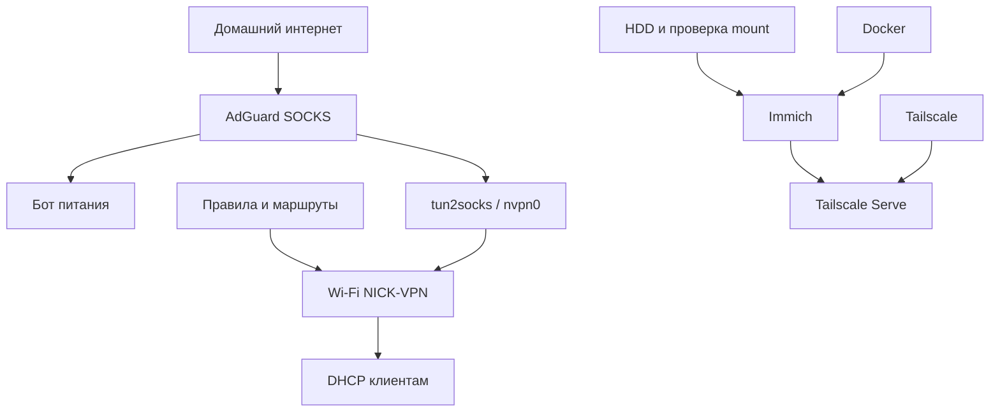

# 9. Карта системы и регулярное обслуживание

[Оглавление](../../README.md) · [Назад](08-troubleshooting.md)

## Паспорт

| Компонент | Последние подтверждённые сведения |
|---|---|
| Сервер | Dell OptiPlex 3050 Micro, i5-6500T, около 8 GB RAM |
| ОС | Debian 13, NICK-SERV, пользователь nick |
| NVMe | KIOXIA 128 GB: ОС, Docker, база PostgreSQL |
| HDD | Seagate ST4000LM024 4 TB, ext4, `/mnt/photos` |
| UUID HDD | `f8d17a00-1f7e-4ed9-86be-2a71af0587b7` |
| Immich | v3.3.5, администратор создан, идёт загрузка фото |
| Docker / Compose | 29.9.2 / v5.6.1 по выводу установки |
| AdGuard | SOCKS под nick, localhost:1080 |
| Wi-Fi | NICK-VPN, wlp3s0, 10.77.0.0/24, tun2socks 2.7.0 |
| Удалённый доступ | Tailscale, приватный HTTPS Serve для Immich |

Это исторические значения из переписки, не мониторинг текущего состояния. Адреса подключения уже использовались в инструкциях репозитория. Пароли, пользовательские ID, личный HTTPS tailnet и внешние IP здесь не публикуются.

## Зависимости



Перезапуск AdGuard затрагивает бота и Wi-Fi. Перезапуск Docker затрагивает Immich и другие контейнеры, но бот работает отдельной службой. Остановка Wi-Fi AP не требует остановки AdGuard. Перезагрузка сервера затрагивает всё.

## Автозапуск

На сервере:

```bash
systemctl is-enabled nutrition-bot adguardvpn-bot tailscaled docker immich nick-wifi-addresses
```

Ожидается enabled для используемых сервисов. Вспомогательные Wi-Fi units могут быть static/disabled: зависимости запускают их через addresses. `enabled` означает настройку запуска, не выполненную проверку reboot.

В старой переписке также фигурирует `tailscale-relay`. Его назначение и необходимость в финальной схеме здесь не установлены. Если служба существует, проверь `systemctl status tailscale-relay --no-pager`; не удаляй и не создавай её по предположению.

## Регулярные действия

| Когда | Что сделать |
|---|---|
| После включения или изменения | Быстрая проверка из раздела 2 и реальная проверка каждого приложения |
| Раз в неделю | Свободное место, failed-службы, свежесть копии бота и дампов Immich |
| Раз в месяц | Температуры, SMART, обновления, независимая копия и выборочное восстановление |
| Перед обновлением | Проверенная копия, записанная версия, план возврата, окно обслуживания |
| После изменения VPN/сети | Проверка бота, Wi-Fi, блокировки без туннеля и удалённого входа |

## Что подтверждено и что осталось

- Подтверждены работа прокси для бота, раздача NICK-VPN, тест блокировки без туннеля и восстановление маршрута после restart.
- Подтверждены первый запуск Immich, четыре healthy на первоначальной проверке, создание администратора и доступ с iPhone через Tailscale.
- LAN-привязка Immich настроена; HTTP 200 проверен с самого сервера. Доступ со второго LAN-устройства и DHCP-резервирование не подтверждены.
- Пользователь сообщил о загрузке фото; полного теста скачанного оригинала и восстановления из копии нет.
- Проверка всей системы после перезагрузки, отрицательный тест защиты диска и независимая копия Immich не подтверждены.
- CPU-лимиты предлагались; их применение не подтверждено. Исторический SMART PASSED не гарантирует состояние сегодня.

## Источники и история

Руководство собрано 08.11.2026 из реальных имён служб, файлов и результатов в четырёх чатах: «Основы», «Создать Telegram-бота питания», «Настроить VPN-точку доступа», «Документировать сервер и план Immich». В этот день сервер не перенастраивался.

[Журнал установки Immich](../PROGRESS.md) сохраняет последовательность событий. Старые инструкции установки лежат на прежних путях для совместимости ссылок, но текущие действия выбирай из этого руководства. Исходники бота и ветка с AI не объединялись автоматически.

Официальные справочники: [AdGuard](https://github.com/AdguardTeam/AdGuardVPNCLI), [NetworkManager](https://networkmanager.pages.freedesktop.org/NetworkManager/NetworkManager/nmcli.html), [tun2socks](https://github.com/xjasonlyu/tun2socks/wiki/Examples), [Immich backup](https://docs.immich.app/administration/backup-and-restore/), [Immich upgrades](https://docs.immich.app/install/upgrading/), [Tailscale Serve](https://tailscale.com/docs/reference/tailscale-cli/serve).
